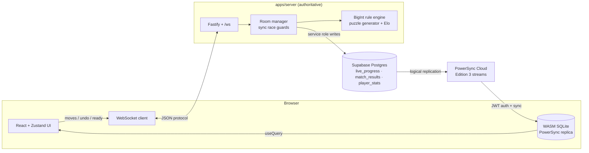

# NumeraRush

**A real-time multiplayer mental-arithmetic arena.** Combine every card with `+ − × ÷` to hit the target before your rival does — with server-authoritative rules, exact `BigInt` rational math, and leaderboards served from an embedded SQLite replica in your browser.

[](https://github.com/rudyxx007/NumeraRush/actions/workflows/ci.yml)

> Demo link and screen recording are added after the cloud deployment steps below are completed.

## Architecture

NumeraRush runs on two deliberately separate paths:

- **Hot path (low latency):** browser ↔ WebSocket (`apps/server`) ↔ in-memory authoritative rule engine. Moves, timers, undo/reset, win detection, scoring, and Elo live only on the server. The browser can never declare a win.
- **Read / sync path (local-first):** `apps/server` writes with the Supabase service role → Supabase Postgres (`live_progress`, `match_results`, `player_stats`) → PowerSync Edition 3 sync streams → embedded WASM SQLite (`@powersync/web`) in each browser. `LiveRacePanel` and `LeaderboardDrawer` read that local replica through `useQuery` from `@powersync/react`, so telemetry never polls REST.



## Engineering decisions & trade-offs

- **WebSockets for play, local SQLite for telemetry.** Gameplay needs strict ordering and sub-100 ms validation, so it stays in server memory. Progress bars and rankings tolerate a second of eventual consistency, so they replicate through PowerSync and render from local SQLite. This keeps the authoritative engine tiny and makes the leaderboard work offline.
- **Exact `BigInt` rationals instead of IEEE-754.** Card values are stored as normalized `{ num, den }` bigints. The classic trap `8 / (3 − 8/3)` evaluates to exactly `24`, and every move is reproducible from serialized decimal strings.
- **Constructive generation, not guess-and-check.** Puzzles are built by merging a random deal down to a single integer inside the difficulty's target window, rejecting oversized intermediates and division by zero. That guarantees 100% solvability (including 7-card `scott_wu`) and produces the verified solution trace used by both the bot runner and the round summary. Deterministic per-tier fallbacks mean generation can never throw.
- **Unique card IDs plus a synchronous round guard.** Cards are addressed by `c_0…`/`m_1…` IDs, so duplicate values cannot confuse a merge. `RoundState.resolved` is checked before any `await`; a simultaneous second winning move receives `STALE_ROUND` instead of double-awarding the round.
- **Server-side bots through the real pipeline.** Bots execute the same verified move plan through the same room manager, timers, Supabase writes, and Elo path as humans — including reversible detours and paced delays.
- **Anonymous auth, read-only clients.** Supabase anonymous sign-ins issue the JWT used for both WebSocket auth and PowerSync client auth. Clients only hold the anon key and have SELECT-only RLS policies; the service-role key never leaves the server.

## Quickstart

Requirements: Node.js 22+, pnpm 9.

```bash
pnpm install
```

Create the env files from the templates:

```bash
cp apps/server/.env.example apps/server/.env
cp apps/web/.env.example apps/web/.env
```

Server (`apps/server/.env`):

| Variable | Purpose |
| --- | --- |
| `PORT` | HTTP/WS port (default `4000`) |
| `CORS_ORIGIN` | Allowed browser origin (default `http://localhost:5173`) |
| `SUPABASE_URL` | Supabase project URL |
| `SUPABASE_SERVICE_ROLE_KEY` | Service-role key used for authoritative writes |

Web (`apps/web/.env`):

| Variable | Purpose |
| --- | --- |
| `VITE_WS_URL` | `ws://localhost:4000/ws` locally |
| `VITE_SUPABASE_URL` | Supabase project URL |
| `VITE_SUPABASE_ANON_KEY` | Public anon key |
| `VITE_POWERSYNC_URL` | PowerSync instance URL |

Run both apps:

```bash
pnpm dev          # server :4000 + web :5173
pnpm test         # Vitest: shared math + server engine/room integration
pnpm typecheck
pnpm check        # Biome lint + format
pnpm build
```

Docker:

```bash
docker compose up --build
```

## Cloud setup

1. **Supabase:** create a project, enable **Auth → Providers → Anonymous Sign-Ins**, then run `infra/supabase/001_init.sql` in the SQL editor. Copy the project URL, anon key, service-role key, and the direct Postgres URI.
2. **PowerSync:** create an instance against the Supabase direct URI, enable **Use Supabase Auth** under Client Auth, and deploy the sync streams in `infra/powersync/sync-config.yaml`.
3. **Deploy the server:** build `apps/server/Dockerfile` on Render/Fly.io (or any Node 22 host) with `PORT`, `HOST=0.0.0.0`, `CORS_ORIGIN`, `SUPABASE_URL`, `SUPABASE_SERVICE_ROLE_KEY`. Check `GET /healthz`.
4. **Deploy the web app:** Vercel with root `apps/web` and build command `pnpm --filter @numera/web build`, output `dist`, plus the four `VITE_*` variables above (`VITE_WS_URL=wss://<server>/ws`).

## Repository layout

```
packages/shared      Exact rational engine, protocol schemas, difficulty constants
apps/server          Fastify WS server, room manager, puzzle generator, Supabase repo, bots
apps/web             React SPA, Zustand UI store, PowerSync replica, competitive UI
infra/               Supabase SQL and PowerSync sync streams
```

Engineering guardrails live in [`AGENTS.md`](./AGENTS.md).

## License

MIT — see [LICENSE](./LICENSE).
